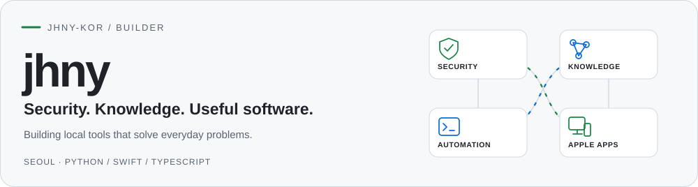
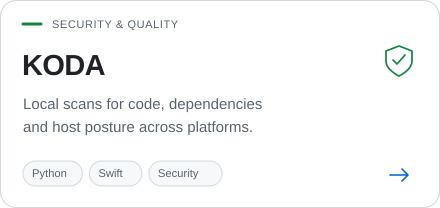
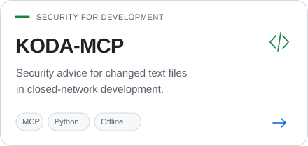
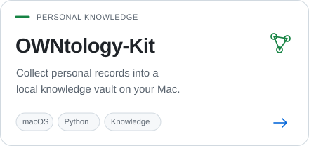
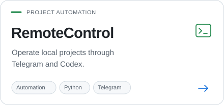
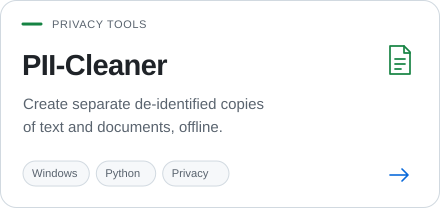
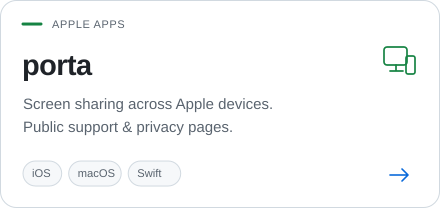
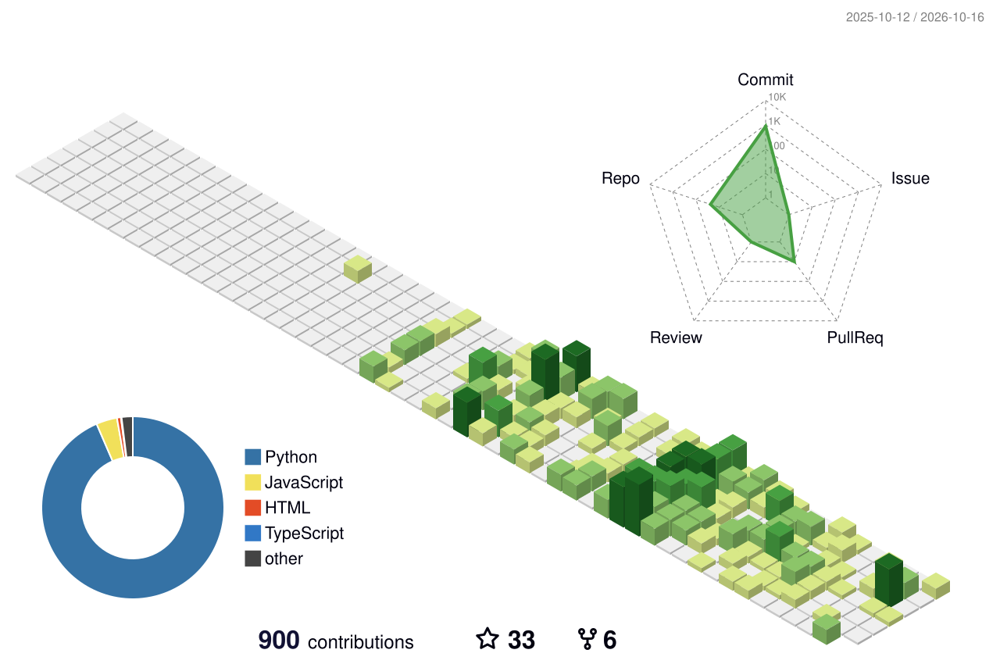

  <picture>
    <source media="(prefers-color-scheme: dark)" srcset="./assets/profile/hero-dark.svg" />
    <source media="(prefers-color-scheme: light)" srcset="./assets/profile/hero-light.svg" />
    
  </picture>

  <strong>보안과 개인 지식, 자동화 도구를 만듭니다.</strong> 
  Security tooling · Local knowledge · Automation · Apple apps

  <a href="#selected-work">Projects</a> &nbsp;·&nbsp;
  <a href="#toolbox">Toolbox</a> &nbsp;·&nbsp;
  <a href="#contribution-graph">3D activity</a> &nbsp;·&nbsp;
  <a href="#connect">Connect</a>

  
  

## Selected Work

  <a href="https://github.com/jhny-kor/KODA"><picture><source media="(prefers-color-scheme: dark)" srcset="./assets/profile/koda-dark.svg" /></picture></a>
  <a href="https://github.com/jhny-kor/KODA-MCP"><picture><source media="(prefers-color-scheme: dark)" srcset="./assets/profile/koda-mcp-dark.svg" /></picture></a>

  <a href="https://github.com/jhny-kor/OWNtology-Kit"><picture><source media="(prefers-color-scheme: dark)" srcset="./assets/profile/owntology-dark.svg" /></picture></a>
  <a href="https://github.com/jhny-kor/RemoteControl"><picture><source media="(prefers-color-scheme: dark)" srcset="./assets/profile/remotecontrol-dark.svg" /></picture></a>

  <a href="https://github.com/jhny-kor/PII-Cleaner"><picture><source media="(prefers-color-scheme: dark)" srcset="./assets/profile/pii-cleaner-dark.svg" /></picture></a>
  <a href="https://github.com/jhny-kor/porta-pages"><picture><source media="(prefers-color-scheme: dark)" srcset="./assets/profile/porta-dark.svg" /></picture></a>

<strong>More projects &amp; current focus</strong>

| Area | Project | Focus |
| --- | --- | --- |
| Cloud operations | [OCI Server Kit](https://github.com/jhny-kor/oci-server-kit) | Terraform setup, public portal, and protected monitoring |
| Finance tools | [TaxMeter](https://github.com/jhny-kor/TaxMeter) | Korean tax/welfare baselines and comparison provenance |
| Trading systems | [AutoCoinTrading](https://github.com/jhny-kor/AutoCoinTrading) | OKX/Upbit replay, risk filters, and decision journals |
| Trading systems | [AutoStockTrading](https://github.com/jhny-kor/AutoStockTrading) | KIS workflows, market checks, and reports |
| Web & information | [AI-News](https://github.com/jhny-kor/AI-News) · [GitHub Pages](https://jhny-kor.github.io) | Public pages and experiments |

Private work includes MuMA, porta, shoebox, my-shoebox, Novalane, arbitrage, OpenTrader, KODA-SBOM-Tracker, gHwpx, markany-ui-automation, and doc-security-evaluation. Public experiments also include [ai-card-news](https://github.com/jhny-kor/ai-card-news).

## Toolbox

  
  
  
  
  
  
  
  
  
  
  
  

<strong>AI coding activity &amp; GitHub streak</strong>

  

  
  
  

Tokscale tracks token usage and estimated cost across local AI coding-agent sessions.

  

## Contribution Graph

  <a href="https://github.com/yoshi389111/github-profile-3d-contrib">
    <picture>
      <source media="(prefers-color-scheme: dark)" srcset="./assets/profile-3d-dark.svg" />
      <source media="(prefers-color-scheme: light)" srcset="./assets/profile-3d-light.svg" />
      
    </picture>
  </a>

3D overview · <a href="https://github.com/jhny-kor?tab=overview#js-contribution-activity-description">날짜별 기여 내역 보기</a>

## Connect

  
  
  
  

Selected work · Profile curated on 2026-10-22

